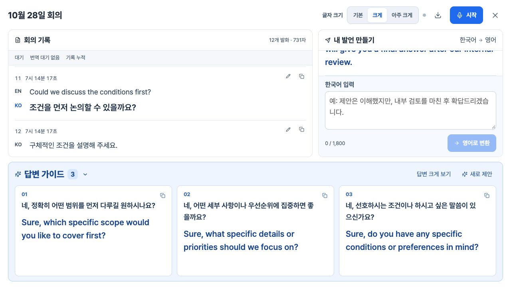

# 가독성 개선 검증 — 2026-10-29

대상: https://emt-theta.vercel.app/ . 회의 기록을 열면 브라우저 전체 폭을 사용하고, 하단 답변 가이드를 큰 글자와 별도의 확대 버튼으로 표시합니다. 상단 글자 크기는 기본 / 크게 / 아주 크게의3단계이며 이 브라우저에 저장됩니다.

## 적용

| 항목 | 기본 | 크게 | 아주 크게 |
|---|---:|---:|---:|
| 음성 원문·직접 입력 한국어·가이드 한국어 |16px|18px|20px|
| 한국어 번역·직접 작성 영어·가이드 영어 |18px|21px|24px|

같은 크기 기준을 데스크톱과 모바일에 사용합니다. 브라우저 종류에 따른 글자 축소는 없습니다. Pretendard Variable을 같은 사이트에서 제공하므로 OS 기본 한글 글꼴 차이에 의존하지 않습니다. 브라우저 자체 확대율·OS 접근성 설정·화면 밀도가 다르면 실제 물리적 크기까지 같게 만들 수는 없습니다. 사용자의 브라우저 확대는 제한하지 않습니다.

회의록은 좌우 여백20px(모바일10px)의 전체 폭 창입니다. 답변 가이드를 다시 열면 펼쳐진 상태로 시작하며 답변 크게 보기/기본 보기로 높이를 조정합니다. 좁은 화면에서는 회의 기록과 내 발언 만들기를 탭으로 전환하고 초안은 유지합니다. 가이드 답변은 세로 스크롤하며, 큰 글자에서도 카드가 겹치지 않게 수정했습니다. 낮은 화면에서는 전체 창을 세로로 스크롤할 수 있고 입력·변환 버튼이 내부에서 잘리지 않습니다.

## 검증

- 자동 회귀 시험108개 통과, 프로덕션 빌드 통과, 공백 오류 검사 통과.
- [실제 앱 내 브라우저18조합](readability-browser-2026-10-29.json):320×740,360×740,390×420,768×1024,1440×900,1920×1080 각각3단계. 같은 사이트 iframe의 실제 CSS viewport를 사용했습니다. 모든 조합에서 전체 폭 일치, 가로 넘침0, 답변 카드 겹침0, 요청한 글자 크기 일치,12개 발화·731자 유지.
- [최종 화면 수치](readability-final-smoke-2026-10-29.json):1280×720에서 크게, 원문18px·번역/가이드21px, 글꼴 로드, 전체 폭1280px, 입력 버튼 노출, 최신 발화 스크롤 유지. 답변 확대 상태에서 입력 버튼 잘림을 발견해 최소 높이/스크롤을 보완하고 다시 확인했습니다.
- 글자 크기 변경 후 새로고침 복원, 회의 기록 다시 열 때 가이드 펼침, 휴대폰 탭 전환 시 입력 초안 보존을 브라우저에서 확인했습니다. UI 변경 후 콘솔 경고·오류0개.
- [검증용 회의 화면](readability-wide-guide-2026-10-29.png)은 로컬 합성 회의 기록입니다. 실제 주변 음성을 수집하지 않았습니다. 이번 작업은 UI 변경으로 새 음성 품질/지연 성능 수치를 주장하지 않습니다.

## 출처와 제한

공식 [Pretendard](https://github.com/orioncactus/pretendard)의 고정 revision6f167519eb309f39104b67a60d33bfcb15495cdc를 사용합니다. font SHA2569599f12fd42fc0bce1cd50b47a0c022e108d7aa64dd0d1bb0ed44f3282d900b4,2,057,688bytes. SIL Open Font License1.1 원문·출처를 public/fonts에 포함했습니다. 외부 CDN 글꼴 연결은 없습니다.

연결된 앱 내 브라우저의 실제 렌더링과 반응형 크기를 검증했습니다. 설치형 Chrome 제어는 정책으로 차단됐고 Edge·휴대폰 실기기는 연결되지 않아 네이티브 브라우저 간 화면 비교는 직접 완료하지 못했습니다. 같은 글꼴 파일·CSS·px값은 적용됐습니다. 사용자는 Chrome/Edge 모두 브라우저 확대율100%에서 새로고침→기록 열기→3단계 변경→답변 크게 보기→가이드 스크롤 순서로 확인할 수 있습니다.

## 운영 배포 확인

배포 ID: `dpl_LHct49fFhCSbcQ1vrARvAeYvgxhc`. 운영 빌드: `66f4805fb192`, 로컬 빌드: `dc0ef84cac1d`. Vercel이 재작성한 vercel.json만 차이가 나며 나머지38개 소스·출처·폰트 파일 해시가 일치합니다. 서로 다른 전체 빌드 ID를 동일하다고 주장하지 않습니다.

[공개 HTTP·소스·폰트 검증](readability-production-2026-10-29.json):비로그인 HTTP200, JS/CSS200, font/woff2 200·2,057,688bytes·정확한 SHA256·1년 immutable 캐시. .env.local과 개발 검증 화면404.

[운영 브라우저 검증](readability-production-browser-2026-10-29.json):829px 화면에서 회의 창 전체 폭829px, 영어18/21/24px3단계·공통 글꼴 로드, 아주 크게 설정 후 새로고침 복원, 기록 재열기 시 가이드 펼침, 콘솔 경고·오류0개. 기존 검증용 직접 입력 결과가 보존됐습니다. [운영 화면](readability-production-2026-10-29.png).

