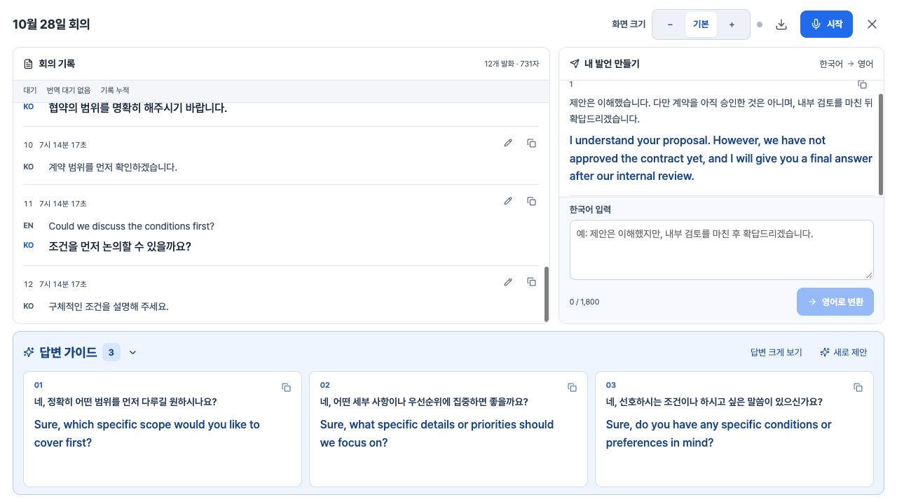

# 화면 크기 이름·기본값 변경 — 2026-10-29

사용자 요청대로 기존 작게→기본, 더 작게→−, 기본→+로 변경했습니다. 버튼 순서는 − / 기본 / +이며, 화면의 실제 크기·여백 배율은 이전 버전과 같습니다. 처음 열 때 중간 크기(원문14px·번역16px)를 기본으로 선택합니다.

| 버튼 | 이전 이름 | 원문 | 번역·영어 결과 |
|---|---|---:|---:|
| − | 더 작게 |13px|14px|
| 기본 | 작게 |14px|16px|
| + | 기본 |16px|18px|

새 저장 키 meeting-screen-size-v3를 사용하며 이전 설정은 새 기본으로 시작합니다. 이후의 선택은 새로고침 후 복원합니다. 키가 없거나 잘못된 값·저장소 오류이면1(중간 크기)로 처리합니다. Number(null)=0으로 큰 화면이 선택되는 오류를 피했습니다. 스크린리더 이름은 화면 축소 / 기본 화면 크기 / 화면 확대이며 버튼 너비 최소44px을 적용했습니다.

[브라우저 검증](size-labels-browser-2026-10-29.json):새 키가 없는 로컬 페이지 기본값1, 세 버튼과13/14·14/16·16/18px 매핑, + 선택 후 새로고침 복원을 확인했습니다.320×740·390×420 각각3단계에서 가로 넘침0, 버튼44×44px 이상입니다. 검증용 기존12개 발화 기록을 사용했고 마이크를 녹음하지 않았습니다. 콘솔 경고·오류0개, [빌드 통과](size-labels-build-2026-10-29.txt), git diff --check 통과.

운영 배포: https://emt-theta.vercel.app/ . ID `dpl_4jxUF2aLzjbfUQcnMtWU6YVg7E1Q`, 운영 빌드 `063c63d1371e`. 공개 HTTP200·JS/CSS200, 플랫폼이 재작성한 vercel.json 외38개 소스·출처·폰트 해시 일치. [HTTP·소스 검증](size-labels-production-2026-10-29.json), [운영 브라우저 검증](size-labels-production-browser-2026-10-29.json). 운영에서도 처음 기본값1, 영어14/16/18px 매핑과 콘솔 경고·오류0개를 확인했습니다.
